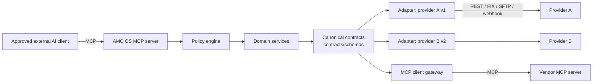

# INT-100 — MCP and Integration Architecture (Proposal)

> **PROPOSAL** — part of the [EA-100](../04_enterprise_architecture/EA-100_ai_orchestration_architecture_proposal.md) set. **No provider endpoint, message format or file layout is specified here.** Each provider spec (Step 14) must be written from the provider's own documentation, confirmed by the provider and the pilot AMC.

## 1. Pattern: adapters behind canonical contracts

| Rule | Detail |
| --- | --- |
| INR-1 | Domains depend only on canonical contracts, never on a provider format. |
| INR-2 | One adapter per provider per interface version; adapters are stateless except for checkpoints. |
| INR-3 | Every inbound record is validated, tagged with source, as-of and extraction run, and quarantined on failure (EA-105 FH-09). |
| INR-4 | Outbound instructions carry idempotency keys and client references; unknown outcomes follow EA-102 §4. |
| INR-5 | Credentials are per tenant in the secrets manager; adapters receive short-lived access, never long-lived secrets in config. |
| INR-6 | Supported transports: REST, FIX, SFTP files, webhooks, MCP, email (inbound parsing only, with human checks). |

## 2. AMC OS as MCP client (consuming vendor MCP servers)

- Vendor MCP servers are reached only through the **MCP client gateway**, which registers each vendor tool in the tool registry as category TC4 (AIML-102) after review: description wording, schema, data class, licence terms.
- Tool descriptions from vendor servers are **untrusted input** (SEC-100 §5): they are pinned at review time; changes require re-review.
- Authorisation follows the MCP specification's OAuth-based model; tokens are per tenant **[VAL — per vendor]**.

## 3. AMC OS as MCP server (exposing its own tools) — optional, OD-8

- Exposes only Approved R0/R1 tools (and, if the owner chooses, R2 draft tools) to external AI clients that the tenant admin has approved.
- Same policy engine and audit as internal agents; no R3; no bulk export.

## 4. Verified MCP availability (as of 20 Nov 2026)

| Provider | MCP server? | Evidence | Constraint |
| --- | --- | --- | --- |
| FactSet | **Yes** — a production MCP server announced 16 Dec 2025, which the release says covers nine datasets (fundamentals, consensus estimates, ownership, M&A, pricing, people, events, supply chain, geographic revenue exposure); and a Portfolio Analytics MCP announced 26 Jun 2026 | [1] "FactSet Meets Demand for AI-Ready Data, First to Announce MCP Sans Intermediary", 16 Dec 2025: [investor.factset.com](https://investor.factset.com/news-releases/news-release-details/factset-meets-demand-ai-ready-data-first-announce-mcp-sans), [GlobeNewswire copy](https://www.globenewswire.com/fr/news-release/2025/12/16/3206057/7768/en/FactSet-Meets-Demand-for-AI-Ready-Data-First-to-Announce-MCP-Sans-Intermediary.html). [2] "FactSet Expands Model Context Protocol Suite to Portfolio Analytics", 26 Jun 2026: [investor.factset.com](https://investor.factset.com/news-releases/news-release-details/factset-expands-model-context-protocol-suite-portfolio-analytics), [Nasdaq copy](https://www.nasdaq.com/press-release/factset-expands-model-context-protocol-suite-portfolio-analytics-2026-06-26). Read via web search by the author on 20 Nov 2026; the reviewer could not open the FactSet site (HTTP 403) | **Licence-dependent.** Access requires the AMC's own FactSet licence. An individual's or employer's licence or MCP access must **not** be assumed to be usable or redistributable through AMC OS. Display and AI-use rights to be confirmed in each AMC's contract **[VAL]** |
| All other providers below | **Not verified** | — | Assume no MCP server; integrate via documented file/API interfaces. Confirm with provider. |

Official MCP SDKs exist for Python and TypeScript (among others), and SDK releases track dated specification revisions (latest announced: 2026-07-28) — [MCP blog, SDK posts](https://blog.modelcontextprotocol.io/tags/sdk/). ADR-0011 proposes pinning the spec version per release.

## 5. Licence and data-use rules

1. Every external data set has a recorded licence: who may see it, whether it may be stored, displayed, shown to AI, or used in derived outputs.
2. AI tools inherit the licence constraints of their source (AIML-102 `licence_constraints`).
3. Data licensed by one tenant is never visible to another tenant, including through embeddings or caches.

## 6. Integration patterns per provider type

All interface details below are **to be confirmed with the provider**; the "likely pattern" column is a planning assumption only **[ASSUMPTION — Head of Integration to confirm with each provider and the pilot AMC]**.

| Provider type | Examples | Direction | Likely pattern (assumption, see above) | SoR for | Must confirm |
| --- | --- | --- | --- | --- | --- |
| Market / reference data | FactSet; exchange data | In | MCP (FactSet) or vendor API/files | Prices, reference | Licence, fields, timing |
| AMFI | NAV and industry data | In; NAV submission out (human) | Public files / portal | Industry data | Formats, timing, submission process |
| Exchanges | NSE, BSE | In | Licensed data feeds / files | Market data | Licence, format |
| RTAs | CAMS, KFintech | In (and possibly out) | Files / APIs per RTA agreement | Investor, folio, transactions | Interfaces offered to the AMC; mirror mode (GOV-006 Q2) |
| Banks | AMC's banks | In/out | Bank host-to-host / API | Cash, payments | Status-query support (EA-102 §5) |
| Custodians | AMC's custodian | In/out | Files / API / SWIFT messages | Holdings, settlement | Instruction status query |
| Brokers | Empanelled brokers | Out/in | FIX or broker-specific | Executions, contract notes | FIX version, order status query |
| KRA / CKYC | KRAs, CKYC registry | In | Through RTA or registered intermediary | KYC status | Which entity holds access |
| Depositories | NSDL, CDSL | In | Via custodian / DP | Demat holdings | Access route |
| AI model providers | Chosen per OD-4 | Out | Provider API through AI gateway | — | Data residency, retention, no-training terms |
| Email / SMS | Chosen vendor | Out | API | — | DLT/TRAI rules for SMS **[VAL — Compliance to confirm]** |
| Identity providers | AMC's IdP | In | OIDC / SAML | User identity | Q6 |

## 7. Health monitoring

Each adapter publishes: last success, lag, error rate, quarantine count, UNKNOWN count. Integration Health agent (AG-U-IH) explains them; it cannot change adapter configuration.
