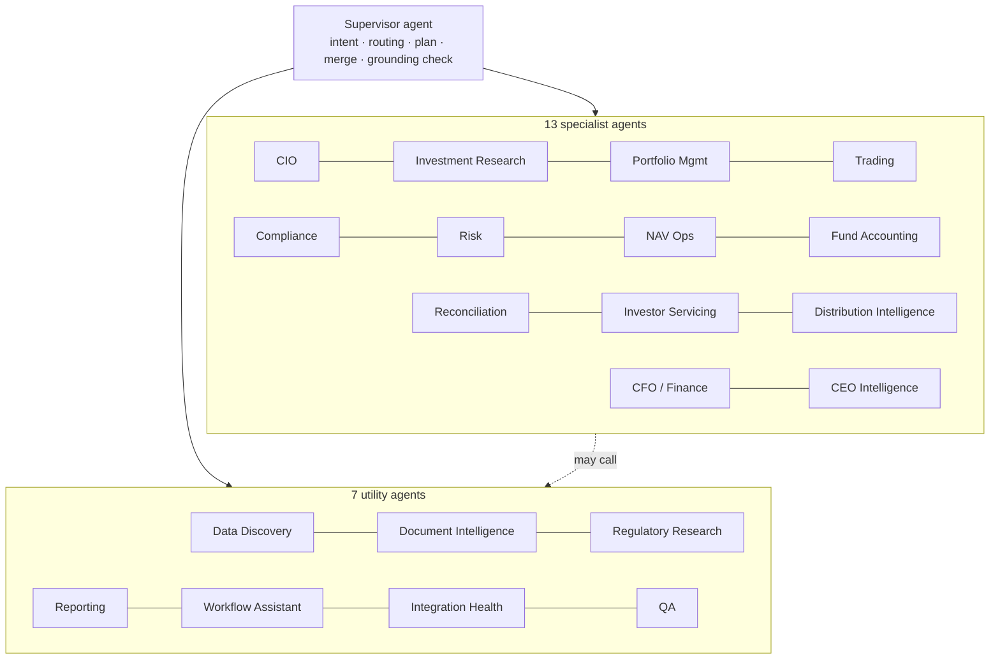

# AIML-100 — Agent Hierarchy and Supervisor (Proposal)

> **PROPOSAL** — part of the [EA-100](../04_enterprise_architecture/EA-100_ai_orchestration_architecture_proposal.md) set. Agents are *logical* roles: one runtime hosts them all (ADR-0010, Draft). Every agent obeys ADR-0008: read, explain, propose — never approve, post, publish or execute.

## 1. Hierarchy

Rules:
1. Users talk to the supervisor (WS-11) or to a workspace's own specialist; both go through the same policy layer.
2. Specialists may call utility agents, never other specialists directly; cross-domain work goes back through the supervisor so the plan and permissions stay visible.
3. Delegation never widens permissions: a sub-agent acts with the **intersection** of the user's and its own permissions (SEC-100).
4. Maximum delegation depth 2 (supervisor → specialist → utility) **[DES]**.

## 2. Supervisor responsibilities

| Step | What it does |
| --- | --- |
| Classify | Intent, domain(s), risk class requested (R0–R3) |
| Check | User permissions and tenant enablement before planning |
| Plan | Ordered sub-tasks with chosen agents; shown to user for multi-step or R2 work |
| Delegate | Calls agents with minimal context needed |
| Merge | Combines results; keeps every number linked to its tool result |
| Ground | Blocks any number not present in a tool output (ADR-0008) |
| Hand off | For R2 actions (and anything needing an R3 human decision), creates a proposal in the target module's approval queue and stops |

## 3. Specialist and utility agents (summary)

Full registry records: [AIML-101](AIML-101_agent_registry_specification.md).

| ID | Agent | Main tasks | Highest risk class it can *request* |
| --- | --- | --- | --- |
| AG-SUP | Supervisor | Route, plan, merge, ground | R2 (draft) |
| AG-CIO | CIO | Cross-fund views, house-view drafts, performance explanation | R1 |
| AG-RES | Investment Research | Company/sector research, notes, factor data | R1 (+R2 draft research note) |
| AG-PM | Portfolio Mgmt | Exposure, what-if, rebalance drafts | R2 (draft orders) |
| AG-TRD | Trading | Blotter summaries, broker analytics, UNKNOWN-queue explanation | R1 |
| AG-CMP | Compliance | Breach explanation, circular impact, rule-change proposals | R2 (draft rule version) |
| AG-RSK | Risk | Risk-driver explanation, scenario set-up drafts | R1 |
| AG-NAV | NAV Ops | NAV movement explanation, exception triage | R1 |
| AG-FA | Fund Accounting | Journal review notes, accrual checks | R1 |
| AG-REC | Reconciliation | Break explanation, match suggestions | R2 (proposed match) |
| AG-INV | Investor Servicing | Investor 360, reply drafts, complaint classification | R2 (draft reply) |
| AG-DIST | Distribution Intelligence | Flow analysis, opportunity lists | R1 |
| AG-CFO | CFO / Finance | P&L and TER variance commentary | R1 |
| AG-CEO | CEO Intelligence | Briefs, board-pack drafts | R1 |
| AG-U-DD | Data Discovery | Find datasets, metrics, lineage | R1 |
| AG-U-DOC | Document Intelligence | Extract from PDFs, contracts, statements (with page refs) | R1 |
| AG-U-REG | Regulatory Research | Search SEBI/AMFI sources, summarise with citations | R0/R1 |
| AG-U-RPT | Reporting | Assemble reports from approved metrics | R1 |
| AG-U-WF | Workflow Assistant | Explain task status, draft task notes | R1 |
| AG-U-IH | Integration Health | Explain adapter failures, lag, UNKNOWN items | R1 |
| AG-U-QA | QA | Check other agents' outputs against sources and schemas | R1 |

No agent can request R3. R3 actions exist only as human actions (SEC-101).

## 4. Domain-to-agent matrix

P = primary agent, S = supporting agent.

| Domain (GOV-001) | Primary | Supporting |
| --- | --- | --- |
| D01 Platform Administration | AG-U-IH | AG-U-WF |
| D02 Product and Scheme Management | **none (OD-9)** | AG-U-DOC, AG-U-REG |
| D03 Investment Management | AG-CIO | AG-RES |
| D04 Portfolio Management | AG-PM | AG-RSK, AG-CMP |
| D05 Order Management System | AG-PM | AG-TRD, AG-CMP |
| D06 Trading and Execution | AG-TRD | AG-U-IH |
| D07 Settlement Management | AG-REC | AG-U-IH |
| D08 Compliance Management | AG-CMP | AG-U-REG, AG-U-DOC |
| D09 Risk Management | AG-RSK | AG-PM |
| D10 Fund Accounting | AG-FA | AG-REC |
| D11 Valuation and NAV | AG-NAV | AG-FA |
| D12 Fund Operations | AG-REC | AG-U-WF |
| D13 Investor Management and Servicing | AG-INV | AG-U-DOC |
| D14 Distribution Management | AG-DIST | AG-U-RPT |
| D15 Finance and Management Reporting | AG-CFO | AG-CEO, AG-U-RPT |
| D16 Enterprise Data Platform | AG-U-DD | AG-U-QA |
| D17 AI and Decision Intelligence | AG-SUP | AG-U-QA |

## 5. Mapping to earlier agent lists (conflict C4)

| PRD-000 §9.3 agent (11) | This proposal |
| --- | --- |
| Research Agent | AG-RES |
| CIO Copilot | AG-CIO |
| Portfolio Agent | AG-PM |
| Compliance Copilot | AG-CMP |
| NAV Operations Agent | AG-NAV |
| Reconciliation Agent | AG-REC |
| Distribution Intelligence Agent | AG-DIST |
| Product Intelligence Agent | **no counterpart** — OD-9 (closest support: AG-U-DD, AG-U-DOC) |
| Investor Service Agent | AG-INV |
| CFO Copilot | AG-CFO |
| CEO Copilot | AG-CEO |

Master prompt §4 D17 lists 11 copilots/assistants (Research, CIO, Dealing, Compliance, Risk, NAV operations, Reconciliation, Investor service, Distribution intelligence, CFO, CEO) plus a RAG knowledge system. They map to AG-RES, AG-CIO, AG-TRD, AG-CMP, AG-RSK, AG-NAV, AG-REC, AG-INV, AG-DIST, AG-CFO and AG-CEO; the RAG knowledge system is platform plumbing used by AG-U-DOC and AG-U-REG, not an agent. The other D17 items are also not agents: the **AI gateway** → ADR-0014; **predictive models, anomaly detection and forecasting** → advisory ML signals (DA-100 §4), to be specified in AIML-002 (GOV-006 Step 26).

New in this proposal (not in PRD-000 §9.3): AG-SUP, AG-TRD (master prompt adds a dealing assistant), AG-RSK (master prompt adds a risk assistant), AG-FA, and the seven utility agents. PRD-000 §9.3 evaluation criteria (for example citation accuracy ≥ 98%, CEO Copilot groundedness 100%) carry over to the matching agents unless WP6 changes them.

## 6. Open items

- OD-9: D02 agent.
- Cost: per-tenant monthly AI budget and per-agent token limits (AIML-103 §4).
- Evaluation suites per agent before enablement (WP6, Step 26).
