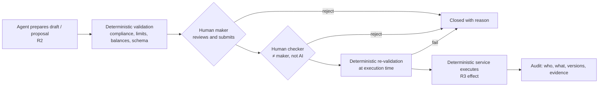

# SEC-101 — Human-in-the-Loop Execution (Proposal)

> **PROPOSAL** — part of the [EA-100](../04_enterprise_architecture/EA-100_ai_orchestration_architecture_proposal.md) set. Approval matrices per workflow come from BA-004/BA-005 (not yet written).

## 1. The one rule

**AI prepares. Humans decide. Deterministic services execute.**

## 2. What the human sees before deciding

- The proposal and its rationale, with every number linked to its source (no unverified AI numbers).
- Deterministic validation results (rule versions, pass/warn/block).
- Differences from the current state.
- Which agent and version prepared it, and which data it used.
- A clear label: "Prepared by AI — review required".

## 3. Approval rules (proposed defaults, to be set per tenant in WP2)

| Action | Maker | Checker | Extra |
| --- | --- | --- | --- |
| Order submit / approve / release | Fund manager | CIO or delegate; dealer releases | Pre-trade compliance at submit and release |
| Journal posting | Accountant | Senior accountant | Balanced-journal check |
| NAV approval / publication (only if SoR mode O) | NAV ops | Fund accountant head | All validations green or waived with reason |
| Payment approval | Ops | Finance (two signatories per bank mandate) | Bank mandate limits **[VAL]** |
| Compliance rule/limit change | Compliance officer | Head of compliance | Effective-dated version; no retroactive change |
| SoR mode, role, agent enablement change | Tenant admin | Second admin | Step-up MFA |

## 4. Prohibited shortcuts

- No "approve all" for R3 items without each item being shown.
- No standing delegation of checker role to a service account.
- No approval from within an AI chat; approvals happen in the module's approval screen.
- Self-approval blocked in the database (DDL-000 trigger) as well as in the application.

## 5. Evidence

Each decision stores: approver identity, time, device/session, what was shown (versioned), validation results, and the AI run ID if AI prepared it (AIML-103).
